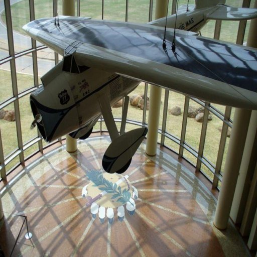
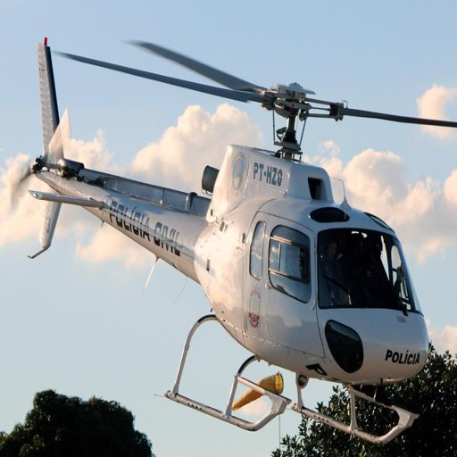

# Data Inspection

This section presents sample records from the dataset, including all fields: **id, image, text, type, and is_member**.

---

## 🔹 Sample 1

* **id:** cauldron_ln_15810
* **image:**

  
* **text:** Please provide a concise description of this image.
  At the top of this image, there is aircraft attached to the threads. Below this aircraft, there is a floor of a building having windows and pillars. In the background, there are rocks, a road and grass on the ground.
* **type:** unseen_both
* **is_member:** 0

---

## 🔹 Sample 2

* **id:** cauldron_ln_24846
* **image:**
  
  
* **text:** In one or two sentences, can you explain what this image depicts?
  In this image I can see houses and trees lake visible in the middle and I can see a person visible in the foreground, at the top I can see the hill. In the middle I can see poles.
* **type:** unseen_both
* **is_member:** 0

---

## 🔹 Sample 3

* **id:** mix_SI_UT_0_19
* **image:**
  
  
* **text:** Could you give a brief overview of what you see in this image?
  In this image we can see a few people, among them some are riding the bicycles on the road, in the background, we can see a building with windows and there are some plants.
* **type:** seen_img_unseen_txt
* **is_member:** 0

---

## 🔹 Sample 4

* **id:** mix_SI_UT_0_896
* **image:**
  
  
* **text:** Describe this image in one or two sentences.
  This picture describes about group of people, in the left side of the image we can see a man, he is holding a guitar, in the middle of the image we can see another man, he is holding a microphone, in the background we can find few musical instruments, metal rods and lights.
* **type:** seen_img_unseen_txt
* **is_member:** 0

---

## 🔹 Sample 5

* **id:** cauldron_ln_138
* **image:**
  
  
* **text:** Can you describe this image briefly?
  In this picture there is a man who is driving a helicopter. At the bottom I can see the trees. In the background I can see the sky and clouds.
* **type:** seen_both
* **is_member:** 1

---

## 🔹 Observations

* The dataset contains paired **image-text inputs** along with metadata.
* The **type** field indicates different training exposure scenarios (seen/unseen).
* The **is_member** field acts as a label for membership inference tasks.
---
